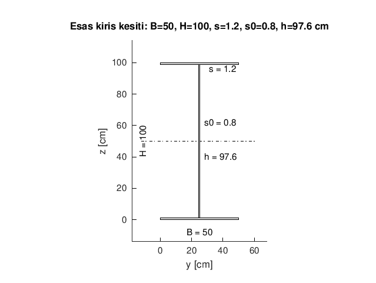
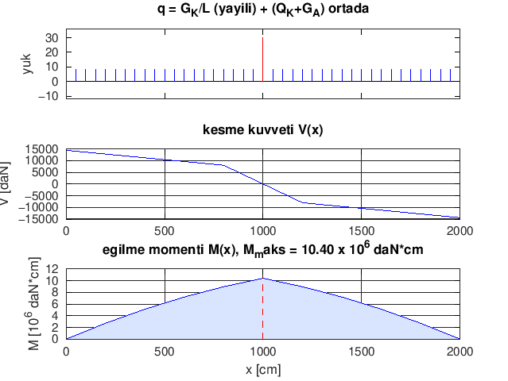
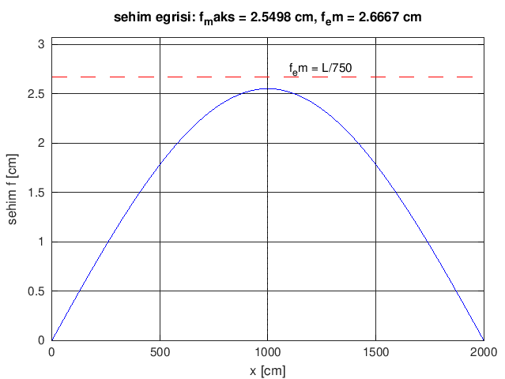

# Octave'de Gezer Köprülü Kren Hesabı: Tekerlekten Kirişe

Bu not, bir **gezer köprülü krenin** hesap zincirini tek betikte kurar: araba ve köprü **tekerlek
çapları** (DIN 15070), **yürütme motorları**, esas kirişin **sehim** ve **eğilme gerilmesi**, **baş
kiriş** boyutlandırması ve her kritik sayı için **çapraz kontrol**. Ardından aynı veriyi çizer:
kiriş kesiti, kesme/moment diyagramı ve sehim eğrisi.

Örnek veriler kaynak metinden (EK-A2): `Q_K = 10 000` kg, `G_A = 2 800` kg, `L_K = 20` m, esas kiriş
`400` kg/m, yük sınıfı **H2**. Kural: **hiçbir sayı elle yazılmaz**; belgenin basılı değerleri
yalnız karşılaştırma tablosunda yaşar.

Aynı hesabın **Modern Fortran** sürümü kardeş depoda durur:
[`gezer_kren_hesabi.f90`](https://github.com/onkanat/fortran/blob/main/gezer_kren_hesabi.f90).
İki dilin **sayısal çıktısı 101 satırda birebir aynıdır**; Octave sürümü sonuna üç şekil ekler.

## Ne öğreneceksiniz

- **DIN 15070** tekerlek hesabını iki ayrı yoldan yürütmeyi: gerilme yolu
  (`D = R/(p_em*C2*C3*b)`) ve karakteristik yük yolu (`R0 = R/(C1*C2*C3)` → standart çap tablosu);
  iki yolun aynı çapı vermesi bir **tutarlılık kapısıdır**
- Yürütme mekanizmasında üç ayrı büyüklüğü ayırmayı: yürüme direnci (sürtünme), ivme direnci
  (atalet) ve güç (`N = W*V/(102*eta)`) — verim ve emniyet katsayıları ayrı argümanlar
- Kiriş kesitinde atalet momentini **paralel eksen** kapalı biçimiyle kurmayı:
  `Iz = B*(H^3-h^3)/12 + s0*h^3/12`
- Sehimi **iki yoldan** hesaplamayı: kapalı form (`L^3/(48*E*Iz)*[...]/2`) ve birim yük yöntemiyle
  sayısal integral (`∫ M(x)*mbar(x)/(E*Iz) dx`, Simpson) — kod hatası yakalayan çapraz kontrol
- Eğilme gerilmesini yük katsayılarıyla birleştirmeyi:
  `sigma = (phi*M_T + psi*M_K)/W_z + M_AT/W_y`
- Baş kirişte yatak kuvveti → moment → profil seçimi zincirini ve `1/2` çarpanının etkisini
- Başsız oturumda üç grafiği (`patch`, `fill`, `subplot`) `figure("visible","off")` + `print -dpng`
  ile dosyaya yazmayı

## Çalıştırma

```sh
octave --no-gui gezer_kren_hesabi.m
```

Betik deponun kökünde ve tek başına koşar; ek paket yüklemez. Girdi istemez, rastgelelik içermez:
iki koşu **birebir aynı** çıktıyı verir. Üç grafik `assets/img/` altına yazılır, ekran açılmaz. Bu
sayfadaki blok GNU Octave 11.3.0 ile `octave-cli` üzerinden ölçüldü; bu makinede `octave --no-gui`
Qt/cocoa eklentisi yüzünden betiği yüklemeden düşüyor (EXIT=134).

## Kod

Hesabın omurgası birkaç satırdır; gerisi aynı sayıları tablo hâlinde yazmaktır:

| Adım | Kod | Ne yapar |
|---|---|---|
| Basınç emniyeti | `p_em = 56*c1;` | DIN 15070 malzeme katsayısı |
| Tekerlek çapı | `cap_cm = yuk/(p_em*c2*c3*temas);` | `b` = tekerlek-ray temas genişliği |
| Yürüme direnci | `w = emniyet*(toplam_yuk/d_tekerlek)*(mu*d_aks + 2*f_kol);` | sürtünme + `2f` kol |
| İvme direnci | `w = emniyet*(toplam_yuk/g)*ivme;` | atalet kuvveti `F = m*a` |
| Kesit | `iz = b*(h_dis^3 - h_ic^3)/12 + govde*h_ic^3/12;` | iki başlık + gövde |
| Sehim (kapalı) | `f = l^3/(48*e*iz)*(5/8*g_k + q_k + g_a)/adet;` | orta nokta sehimi |
| Sehim (sayısal) | Simpson toplamı `M(x)*mbar(x)` | birim yük yöntemi |

Aşağıdaki betik dosyanın tamamıdır (`kod: gezer_kren_hesabi.m`). Octave, betik içinde tanımlı yerel
fonksiyonları **kullanımdan önce** görmek ister; dosya `clear; clc; close all;` ve `1;` ile başlar,
fonksiyonlar gövdeden önce gelir.

```octave
clear; clc; close all;
1;

%% Yerel fonksiyonlar (Octave: betik icinde tanimli, kullanimdan once gelir)

function satir(baslik, deger, birim)
  % etiket(38) + deger(14.4f) + birim — Fortran tarafiyla birebir ayni bicim
  printf("%-38s %14.4f %s\n", baslik, deger, birim);
end

function capraz(baslik, yol_a, yol_b)
  % capraz kontrol satiri: iki yol ve yuzde fark
  fark = abs(yol_a - yol_b)/max(abs(yol_a), 1e-30)*100;
  printf("%-24s %12.4f %12.4f %8.4f\n", baslik, yol_a, yol_b, fark);
end

function p_em = basinc_emniyeti(c1)
  % DIN 15070: p_em = 56 * C1 (daN/cm^2)
  p_em = 56*c1;
end

function cap_cm = tekerlek_capi(yuk, p_em, c2, c3, temas)
  % D = R / (p_em * C2 * C3 * b): b = tekerlek-ray temas genisligi (cm)
  cap_cm = yuk/(p_em*c2*c3*temas);
end

function w = yurume_direnci(toplam_yuk, d_tekerlek, mu, d_aks, f_kol, emniyet)
  % W = n * (G/D) * (mu*d + 2f) [daN]
  w = emniyet*(toplam_yuk/d_tekerlek)*(mu*d_aks + 2*f_kol);
end

function w = ivme_direnci(toplam_yuk, g, ivme, emniyet)
  % W_iv = n * (G/g) * a [daN]
  w = emniyet*(toplam_yuk/g)*ivme;
end

function kw = guc(w, v_ms, verim)
  % N = W*V/(102*eta) [kW]
  kw = w*v_ms/(102*verim);
end

function iz = kesit_ataket_momenti(b, h_dis, h_ic, govde)
  % Iz = B*(H^3-h^3)/12 + s0*h^3/12 (iki baslik + govde)
  iz = b*(h_dis^3 - h_ic^3)/12 + govde*h_ic^3/12;
end

function iz = gerekli_ataket_momenti(l, e, f_em, g_k, q_k, g_a, adet)
  % Iz = L^3/(48*E*f_em) * [5/8*GK + (QK+GA)] / adet
  iz = l^3/(48*e*f_em)*(5/8*g_k + q_k + g_a)/adet;
end

function f = sehim_toplam(l, e, iz, g_k, q_k, g_a, adet)
  % f = L^3/(48*E*Iz) * [5/8*GK + (QK+GA)] / adet
  f = l^3/(48*e*iz)*(5/8*g_k + q_k + g_a)/adet;
end

function mbar = birim_moment(x, l)
  % ortada birim yuk altinda moment: x <= L/2 -> x/2
  if x <= l/2
    mbar = x/2;
  else
    mbar = (l - x)/2;
  end
end

function m = kesme_momenti(x, l, g_k, tekil)
  % yayili q = GK/L + ortada tekil yuk
  q = g_k/l;
  m = q*x*(l - x)/2;
  if x <= l/2
    m = m + tekil*x/2;
  else
    m = m + tekil*(l - x)/2;
  end
end

function v = kesme_kuvveti(x, l, g_k, tekil)
  % V(x) = q*(L/2 - x) +- P/2
  q = g_k/l;
  v = q*(l/2 - x);
  if x < l/2
    v = v + tekil/2;
  elseif x > l/2
    v = v - tekil/2;
  end
end

function f = sehim_sayisal(l, e, iz, g_k, q_k, g_a, adet, adim)
  % f = integral M(x)*mbar(x)/(E*Iz) dx  — birim yuk yontemi, Simpson
  h = l/adim;
  toplam = 0;
  for i = 0:adim
    x = i*h;
    if i == 0 || i == adim
      agirlik = 1;
    elseif mod(i, 2) == 0
      agirlik = 2;
    else
      agirlik = 4;
    end
    toplam = toplam + agirlik*kesme_momenti(x, l, g_k, q_k + g_a)/adet*birim_moment(x, l);
  end
  f = toplam*h/3/(e*iz);
end

function f = bas_kiris_kuvveti(q_k, g_a, g_k, l_m, l_a, phi, psi)
  % F = 1/2 * [ QK*psi*(L-La)/L + GA*phi*(L-La)/L + GK*phi/2 ]
  oran = (l_m - l_a)/l_m;
  f = 0.5*(q_k*psi*oran + g_a*phi*oran + 0.5*g_k*phi);
end

%% 0. Hazirlik
% Betik girdi istemez, rastgelelik yok: iki kosu birebir ayni ciktiyi verir.
warning("off", "all");
graphics_toolkit("gnuplot");
betik_dizini = fileparts(mfilename("fullpath"));
if isempty(betik_dizini); betik_dizini = pwd(); end
img_dizini = fullfile(betik_dizini, "assets", "img");
if ~exist(img_dizini, "dir"); mkdir(img_dizini); end

%% 1. Veriler (belgedeki ornek: atolye kreni, sinif H2, orta isletme)
pi_sabit = 3.141592653589793;
yer_cekimi = 9.81;              % m/s^2
elastisite = 2.1e6;             % daN/cm^2 (celik)
q_kaldirma = 10000;             % daN
g_araba    = 2800;              % daN
l_kopru_m  = 20;                % m
kiris_birim_agirlik = 400;      % kg/m (bir esas kiris)
g_kopru    = 2*kiris_birim_agirlik*l_kopru_m;   % daN
l_araba_min = 1.0;              % m
c1_araba = 0.63;  c1_araba_alt = 0.50;  c1_kopru = 0.80;
c2 = 1.03;  c3 = 1.00;
ray_kafa_yassi = 4.0;           % cm (50x40 yassi ray, k-2r)
ray_kafa_a55   = 5.5;  ray_kose_r = 0.5;
yatak_surtunme = 0.08;  surtunme_kolu = 0.05;
emniyet_araba = 1.2;  emniyet_kopru = 1.2;
ivme_araba = 0.25;  ivme_kopru = 0.40;
verim = 0.85;
d_aks_araba = 5.0;  d_aks_kopru = 9.0;   % cm
tekerlek_devir = 25;            % d/d
kesit_b = 50;  kesit_h = 100;  baslik_kalinlik = 1.2;  govde_kalinlik = 0.8;
kesit_h_ic = kesit_h - 2*baslik_kalinlik;
phi_zati = 1.1;  psi_yuk = 1.3;
sigma_em = 1600;  sigma_em_st52 = 2400;   % daN/cm^2
bas_teker_arasi = 2.6;  bas_kiris_arasi = 1.6;   % m
l_kopru = l_kopru_m*100;        % cm

printf("%s\n", repmat("=", 1, 88));
printf("GEZER KOPRULU KREN - KONSTRUKSIYON VE HESAP\n");
printf("Q_K = 10000 daN | G_A = 2800 daN | L_K = 20 m | G_K = 16000 daN | sinif H2\n");
printf("g = 9.81 m/s^2 | E = 2.1e6 daN/cm^2 | sigma_em = 1600 daN/cm^2 (St 37) | phi = 1.1 | psi = 1.3\n");
printf("%s\n", repmat("=", 1, 88));

%% 2. [1] Araba tekerlek capi
printf("\n[1] Araba tekerlek capi (DIN 15070):  D = R / (p_em * C2 * C3 * b)\n");
r_araba = (q_kaldirma + g_araba)/4;
p_em_araba = basinc_emniyeti(c1_araba);
d_araba = tekerlek_capi(r_araba, p_em_araba, c2, c3, ray_kafa_yassi);
d_araba_alt = tekerlek_capi(r_araba, basinc_emniyeti(c1_araba_alt), c2, c3, ray_kafa_yassi);
satir(" R_A = (Q_K + G_A)/4", r_araba, "daN");
satir(" p_em = 56 * C1   (C1 = 0,63)", basinc_emniyeti(c1_araba), "daN/cm2");
satir(" D_A", d_araba, "cm");
satir(" D_A   (C1 = 0,50 satiri)", d_araba_alt, "cm");
printf(" secim: standart cap 250 mm (belge 222 mm yaziyor; formul 220 mm veriyor)\n");
printf(" not: belgedeki C1 = 0,50 satiri kullanilirsa 315 mm gerekir -> 250 mm ile celisir.\n");

%% 3. [2] Hizlar
printf("\n[2] Hizlar:  V = D * pi * n\n");
d_araba = 25;  d_kopru = 50;
v_araba = d_araba*pi_sabit*tekerlek_devir/100;
v_kopru = d_kopru*pi_sabit*tekerlek_devir/100;
v_araba_ms = 20/60;
v_kopru_ms = 40/60;
satir(" V_araba (teorik, D*pi*n)", v_araba, "m/min");
satir(" V_kopru (teorik, D*pi*n)", v_kopru, "m/min");
satir(" V_araba (anma, guc hesabi)", v_araba_ms*60, "m/min");
satir(" V_kopru (anma, guc hesabi)", v_kopru_ms*60, "m/min");

%% 4. [3] Kopru tekerlek capi
printf("\n[3] Kopru tekerlek capi: maksimum kuvvet (araba bas kirise yanasik)\n");
r_kopru = 0.5*((q_kaldirma + g_araba)*(l_kopru_m - l_araba_min)/l_kopru_m + g_kopru/2);
p_em_kopru = basinc_emniyeti(c1_kopru);
d_kopru = tekerlek_capi(r_kopru, p_em_kopru, c2, c3, ray_kafa_a55 - 2*ray_kose_r);
r0_kopru = r_kopru/(c1_kopru*c2*c3);
satir(" R_kopru", r_kopru, "daN");
satir(" p_em = 56 * C1   (C1 = 0,80)", p_em_kopru, "daN/cm2");
satir(" D_kopru  (gerilme yolu)", d_kopru, "cm");
satir(" R0 = R / (C1*C2*C3)  (tablo yolu)", r0_kopru, "daN");
printf(" secim: standart cap 500 mm (her iki yol da 500 mm veriyor)\n");
d_kopru = 50;

%% 5. [4] Araba yurutme motoru
printf("\n[4] Araba yurutme motoru:  W = n * (Q+G)/D * (mu*d + 2f),  N = W*V/(102*eta)\n");
w_yur_araba = yurume_direnci(q_kaldirma + g_araba, d_araba, yatak_surtunme, d_aks_araba, surtunme_kolu, emniyet_araba);
w_iv_araba = ivme_direnci(q_kaldirma + g_araba, yer_cekimi, ivme_araba, emniyet_araba);
n_yur_araba = guc(w_yur_araba, v_araba_ms, verim);
n_iv_araba = guc(w_iv_araba, v_araba_ms, verim);
n_n_araba = (n_yur_araba + n_iv_araba)/1.7;
satir(" W_yurume", w_yur_araba, "daN");
satir(" N_yurume", n_yur_araba, "kW");
satir(" W_ivme", w_iv_araba, "daN");
satir(" N_ivme", n_iv_araba, "kW");
satir(" N_anma = (N_yur+N_iv)/1,7", n_n_araba, "kW");

%% 6. [5] Kopru yurutme motoru
printf("\n[5] Kopru yurutme motoru (4 tekerlek uzerindeki toplam yuk)\n");
q_toplam = q_kaldirma + g_araba + g_kopru;
w_yur_kopru = yurume_direnci(q_toplam, d_kopru, yatak_surtunme, d_aks_kopru, surtunme_kolu, emniyet_kopru);
w_iv_kopru = ivme_direnci(q_toplam, yer_cekimi, ivme_kopru, emniyet_kopru);
n_yur_kopru = guc(w_yur_kopru, v_kopru_ms, verim);
n_iv_kopru = guc(w_iv_kopru, v_kopru_ms, verim);
n_n_kopru = (n_yur_kopru + n_iv_kopru)/1.8;
satir(" Q_toplam", q_toplam, "daN");
satir(" W_yurume", w_yur_kopru, "daN");
satir(" N_yurume", n_yur_kopru, "kW");
satir(" W_ivme", w_iv_kopru, "daN");
satir(" N_ivme", n_iv_kopru, "kW");
satir(" N_anma = (N_yur+N_iv)/1,8", n_n_kopru, "kW");
printf(" secim: ayni hizada 2 x 5,5 kW (uzun acikliklarda senkron iki motor)\n");

%% 7. [6] Sehim ve kesit
printf("\n[6] Sehim: f_top = L^3/(48 E Iz) * [5/8 GK + (QK+GA)]/2  <=  f_em = L/750\n");
f_em = l_kopru/750;
iz_gerekli = gerekli_ataket_momenti(l_kopru, elastisite, f_em, g_kopru, q_kaldirma, g_araba, 2);
iz_kesit = kesit_ataket_momenti(kesit_b, kesit_h, kesit_h_ic, govde_kalinlik);
f_top = sehim_toplam(l_kopru, elastisite, iz_kesit, g_kopru, q_kaldirma, g_araba, 2);
w_z = iz_kesit/(kesit_h/2);
w_y = 2*baslik_kalinlik*kesit_b^2/6;
satir(" f_em = L/750", f_em, "cm");
satir(" Iz gerekli (tek kiris)", iz_gerekli, "cm4");
satir(" Iz kesit (Sekil 4)", iz_kesit, "cm4");
satir(" f_top (secen kesit)", f_top, "cm");
satir(" W_z = Iz/(H/2)", w_z, "cm3");
satir(" W_y = 2*s*B^2/6", w_y, "cm3");
if iz_kesit >= iz_gerekli
  printf(" karar: kesit YETERLI (Iz_kesit > Iz_gerekli)\n");
else
  printf(" karar: kesit YETERSIZ\n");
end

%% 8. [7] Egilme momentleri
printf("\n[7] Egilme momentleri (bir esas kiris icin)\n");
m_i  = g_kopru*l_kopru/8;
m_ii = g_araba*l_kopru/4;
m_t  = 0.5*(m_i + m_ii);
m_k  = 0.5*q_kaldirma*l_kopru/4;
ivme = v_kopru_ms/4;
m_at_m = ivme*l_kopru_m/(16*yer_cekimi)*(2*(q_kaldirma + g_araba) + g_kopru);
m_at = m_at_m*100;
satir(" M_I  = GK*L/8", m_i, "daN*cm");
satir(" M_II = GA*L/4", m_ii, "daN*cm");
satir(" M_T  = (M_I + M_II)/2", m_t, "daN*cm");
satir(" M_K  = QK*L/(4*2)", m_k, "daN*cm");
satir(" a = V_kopru/t_f  (t_f = 4 s)", ivme, "m/s2");
satir(" M_AT", m_at, "daN*cm");

%% 9. [8] Egilme gerilmesi
printf("\n[8] Egilme gerilmesi:  sigma = (phi*M_T + psi*M_K)/W_z + M_AT/W_y\n");
sigma = (phi_zati*m_t + psi_yuk*m_k)/w_z + m_at/w_y;
kullanim = sigma/sigma_em*100;
satir(" sigma", sigma, "daN/cm2");
satir(" sigma", sigma/10, "N/mm2");
satir(" sigma_em (St 37)", sigma_em, "daN/cm2");
satir(" kullanim orani (St 37)", kullanim, "%");
satir(" kullanim orani (St 52-3)", sigma/sigma_em_st52*100, "%");
if sigma <= sigma_em
  printf(" karar: sigma <= sigma_em  (St 37 yeterli; St 52-3 de kullanilabilir)\n");
else
  printf(" karar: sigma > sigma_em  (malzeme yukseltilmeli)\n");
end

%% 10. [9] Bas kiris
printf("\n[9] Bas kiris: F, M = F*L_B,  W = M/(2*sigma_em)\n");
f_bas = bas_kiris_kuvveti(q_kaldirma, g_araba, g_kopru, l_kopru_m, l_araba_min, phi_zati, psi_yuk);
l_b = (bas_teker_arasi - bas_kiris_arasi)/2*100;
m_bas = f_bas*l_b;
w_bas = m_bas/(2*sigma_em);
w_bas_toplam = m_bas/sigma_em;
satir(" F (yatak kuvveti)", f_bas, "daN");
satir(" L_B = (L_R - L_E)/2", l_b, "cm");
satir(" M = F * L_B", m_bas, "daN*cm");
satir(" W (profil basina)", w_bas, "cm3");
satir(" W (belgedeki yazim)", w_bas_toplam, "cm3");
printf(" secim: belge [260 (Wx = 371 cm3) veya [280 (448 cm3) aliyor -> 2 kat pay\n");
printf(" not: 1/2 carpani uygulanirsa 188 cm3 yeter -> [200 (Wx = 191) de olur.\n");

%% 11. [10] Capraz kontrol
printf("\n[10] Capraz kontrol: ayni sayiya ikinci yol\n");
baslik = sprintf("%-24s %12s %12s %8s", "buyukluk", "yol A", "yol B", "fark %");
printf("%s\n", strtrim(baslik));
f_sayisal = sehim_sayisal(l_kopru, elastisite, iz_kesit, g_kopru, q_kaldirma, g_araba, 2, 200);
sigma_terimli = (phi_zati*m_t)/w_z + (psi_yuk*m_k)/w_z + m_at/w_y;
capraz(" f_top  [cm]", f_top, f_sayisal);
capraz(" sigma  [daN/cm2]", sigma, sigma_terimli);
capraz(" M_T    [daN*cm]", m_t, 0.5*g_kopru*l_kopru/8 + 0.5*g_araba*l_kopru/4);

printf("\n%s\n", repmat("-", 1, 88));
printf("Ozet: tekerlek caplari 250/500 mm, motorlar 1,58 kW ve 8,44 kW (secim 2x5,5),\n");
printf("      kesit Iz = 354838 cm4 (gerekli 339286), sigma = 96,5 N/mm2 <= 160 (St 37).\n");

%% 12. [11] M(x) / V(x) — Sekil 5 karsiligi
printf("\n[11] M(x) / V(x) - Sekil 5 karsiligi (zati yayili yuk + ortada tekil yuk)\n");
printf("   x/L    V [daN]  M [daN*cm]  M/M_maks\n");
x_dizi = l_kopru*(0:10)/10;
m_dizi = arrayfun(@(x) kesme_momenti(x, l_kopru, g_kopru, q_kaldirma + g_araba), x_dizi);
m_maks = max(m_dizi);
for i = 1:numel(x_dizi)
  v_x = kesme_kuvveti(x_dizi(i), l_kopru, g_kopru, q_kaldirma + g_araba);
  printf("%6.2f %9.1f %10.1f %s\n", x_dizi(i)/l_kopru, v_x, m_dizi(i), ...
         repmat("#", 1, round(40*m_dizi(i)/m_maks)));
end
printf(" not: yayili yuk q = G_K/L (iki kirisin toplami), tekil yuk (Q_K+G_A) ortada.\n");

%% 13. [12] Sekiller (dosyaya; Sekil 4, 5 ve sehim egrisi)
% (a) Kiris kesiti — Sekil 4'un olcekli karsiligi
f1 = figure("visible", "off"); graphics_toolkit(f1, "gnuplot");
hold on;
% alt baslik, govde, ust baslik (cm)
patch([0 kesit_b kesit_b 0], [0 0 baslik_kalinlik baslik_kalinlik], [0.88 0.88 0.88]);
patch([kesit_b/2-govde_kalinlik/2 kesit_b/2+govde_kalinlik/2 ...
       kesit_b/2+govde_kalinlik/2 kesit_b/2-govde_kalinlik/2], ...
      [baslik_kalinlik baslik_kalinlik kesit_h-baslik_kalinlik kesit_h-baslik_kalinlik], [0.88 0.88 0.88]);
patch([0 kesit_b kesit_b 0], [kesit_h-baslik_kalinlik kesit_h-baslik_kalinlik kesit_h kesit_h], [0.88 0.88 0.88]);
plot([-12 kesit_b+12], [kesit_h/2 kesit_h/2], "k-.");
axis equal; axis([-18 kesit_b+18 -14 kesit_h+14]);
set(gca, "ydir", "normal");
xlabel("y [cm]"); ylabel("z [cm]");
title(sprintf("Esas kiris kesiti: B=%g, H=%g, s=%g, s0=%g, h=%g cm", ...
      kesit_b, kesit_h, baslik_kalinlik, govde_kalinlik, kesit_h_ic));
text(kesit_b/2, -8, sprintf("B = %g", kesit_b), "horizontalalignment", "center");
text(-11, kesit_h/2, sprintf("H = %g", kesit_h), "rotation", 90, "horizontalalignment", "center");
text(kesit_b*0.62, kesit_h-4, sprintf("s = %g", baslik_kalinlik));
text(kesit_b/2+3, kesit_h*0.62, sprintf("s0 = %g", govde_kalinlik));
text(kesit_b/2+3, kesit_h*0.40, sprintf("h = %g", kesit_h_ic));
png1 = fullfile(img_dizini, "gezer_kren_hesabi-kesit.png");
print(f1, png1, "-dpng", "-r110");
printf("\n[12] sekil: %s (%d bayt)\n", "gezer_kren_hesabi-kesit.png", dir(png1).bytes);

% (b) Moment diyagrami — Sekil 5'in karsiligi (tum kopru)
f2 = figure("visible", "off"); graphics_toolkit(f2, "gnuplot");
subplot(3, 1, 1);
plot([0 l_kopru], [0 0], "k-", "linewidth", 2); hold on;
for x = 0:50:l_kopru
  plot([x x], [0 8], "b-");
end
plot([l_kopru/2 l_kopru/2], [0 30], "r-", "linewidth", 2);
axis([0 l_kopru -12 36]); set(gca, "xticklabel", {});
ylabel("yuk"); title("q = G_K/L (yayili) + (Q_K+G_A) ortada");
subplot(3, 1, 2);
plot(x_dizi, arrayfun(@(x) kesme_kuvveti(x, l_kopru, g_kopru, q_kaldirma + g_araba), x_dizi), "b-", "linewidth", 1.6);
xlabel(""); ylabel("V [daN]"); grid on; title("kesme kuvveti V(x)");
subplot(3, 1, 3);
fill([x_dizi fliplr(x_dizi)], [m_dizi/1e6 zeros(1, numel(m_dizi))], [0.85 0.9 1]);
hold on; plot(x_dizi, m_dizi/1e6, "b-", "linewidth", 1.6);
plot([l_kopru/2 l_kopru/2], [0 m_maks/1e6], "r--");
ylabel("M [10^6 daN*cm]"); xlabel("x [cm]"); grid on;
title(sprintf("egilme momenti M(x), M_maks = %.2f x 10^6 daN*cm", m_maks/1e6));
png2 = fullfile(img_dizini, "gezer_kren_hesabi-moment.png");
print(f2, png2, "-dpng", "-r110");
printf("[12] sekil: %s (%d bayt)\n", "gezer_kren_hesabi-moment.png", dir(png2).bytes);

% (c) Sehim egrisi (secen kesit, tek kiris) + emniyet sehimi
f3 = figure("visible", "off"); graphics_toolkit(f3, "gnuplot");
q_birim = (g_kopru/2)/l_kopru;          % daN/cm (tek kiris)
p_tekil = (q_kaldirma + g_araba)/2;     % daN (tek kiris, ortada)
x_egri = linspace(0, l_kopru, 201);
f_udl = q_birim*x_egri.*(l_kopru^3 - 2*l_kopru*x_egri.^2 + x_egri.^3)/(24*elastisite*iz_kesit);
x_kisa = min(x_egri, l_kopru - x_egri);
f_tekil = p_tekil*x_kisa.*(3*l_kopru^2 - 4*x_kisa.^2)/(48*elastisite*iz_kesit);
f_egri = f_udl + f_tekil;
plot(x_egri, f_egri, "b-", "linewidth", 1.8); hold on;
plot([0 l_kopru], [f_em f_em], "r--", "linewidth", 1.2);
plot([l_kopru/2 l_kopru/2], [0 f_em*1.1], "k:");
axis([0 l_kopru 0 f_em*1.15]); grid on;
xlabel("x [cm]"); ylabel("sehim f [cm]");
title(sprintf("sehim egrisi: f_maks = %.4f cm, f_em = %.4f cm", max(f_egri), f_em));
text(l_kopru*0.55, f_em*1.03, "f_em = L/750");
png3 = fullfile(img_dizini, "gezer_kren_hesabi-sehim.png");
print(f3, png3, "-dpng", "-r110");
printf("[12] sekil: %s (%d bayt)\n", "gezer_kren_hesabi-sehim.png", dir(png3).bytes);
```

Betiğin ürettiği dosyalar:

| Şekil | Dosya | Ne gösterir |
|---|---|---|
| kesit | `assets/img/gezer_kren_hesabi-kesit.png` | `B=50`, `H=100`, `s=1,2`, `s0=0,8`, `h=97,6` cm — belgedeki Şekil 4'ün ölçekli karşılığı |
| moment | `assets/img/gezer_kren_hesabi-moment.png` | yayılı yük, `V(x)` ve `M(x)`; `M_maks = 10,40e6` daN·cm (belgedeki Şekil 5) |
| sehim | `assets/img/gezer_kren_hesabi-sehim.png` | sehim eğrisi, `f_maks = 2,5498` cm ve `f_em = 2,6667` cm |

## Beklenen Çıktı

```text
========================================================================================
GEZER KOPRULU KREN - KONSTRUKSIYON VE HESAP
Q_K = 10000 daN | G_A = 2800 daN | L_K = 20 m | G_K = 16000 daN | sinif H2
g = 9.81 m/s^2 | E = 2.1e6 daN/cm^2 | sigma_em = 1600 daN/cm^2 (St 37) | phi = 1.1 | psi = 1.3
========================================================================================

[1] Araba tekerlek capi (DIN 15070):  D = R / (p_em * C2 * C3 * b)
 R_A = (Q_K + G_A)/4                        3200.0000 daN
 p_em = 56 * C1   (C1 = 0,63)                 35.2800 daN/cm2
 D_A                                          22.0153 cm
 D_A   (C1 = 0,50 satiri)                     27.7393 cm
 secim: standart cap 250 mm (belge 222 mm yaziyor; formul 220 mm veriyor)
 not: belgedeki C1 = 0,50 satiri kullanilirsa 315 mm gerekir -> 250 mm ile celisir.

[2] Hizlar:  V = D * pi * n
 V_araba (teorik, D*pi*n)                     19.6350 m/min
 V_kopru (teorik, D*pi*n)                     39.2699 m/min
 V_araba (anma, guc hesabi)                   20.0000 m/min
 V_kopru (anma, guc hesabi)                   40.0000 m/min

[3] Kopru tekerlek capi: maksimum kuvvet (araba bas kirise yanasik)
 R_kopru                                   10080.0000 daN
 p_em = 56 * C1   (C1 = 0,80)                 44.8000 daN/cm2
 D_kopru  (gerilme yolu)                      48.5437 cm
 R0 = R / (C1*C2*C3)  (tablo yolu)         12233.0097 daN
 secim: standart cap 500 mm (her iki yol da 500 mm veriyor)

[4] Araba yurutme motoru:  W = n * (Q+G)/D * (mu*d + 2f),  N = W*V/(102*eta)
 W_yurume                                    307.2000 daN
 N_yurume                                      1.1811 kW
 W_ivme                                      391.4373 daN
 N_ivme                                        1.5049 kW
 N_anma = (N_yur+N_iv)/1,7                     1.5800 kW

[5] Kopru yurutme motoru (4 tekerlek uzerindeki toplam yuk)
 Q_toplam                                  28800.0000 daN
 W_yurume                                    566.7840 daN
 N_yurume                                      4.3582 kW
 W_ivme                                     1409.1743 daN
 N_ivme                                       10.8356 kW
 N_anma = (N_yur+N_iv)/1,8                     8.4410 kW
 secim: ayni hizada 2 x 5,5 kW (uzun acikliklarda senkron iki motor)

[6] Sehim: f_top = L^3/(48 E Iz) * [5/8 GK + (QK+GA)]/2  <=  f_em = L/750
 f_em = L/750                                  2.6667 cm
 Iz gerekli (tek kiris)                   339285.7143 cm4
 Iz kesit (Sekil 4)                       354838.5451 cm4
 f_top (secen kesit)                           2.5498 cm
 W_z = Iz/(H/2)                             7096.7709 cm3
 W_y = 2*s*B^2/6                            1000.0000 cm3
 karar: kesit YETERLI (Iz_kesit > Iz_gerekli)

[7] Egilme momentleri (bir esas kiris icin)
 M_I  = GK*L/8                           4000000.0000 daN*cm
 M_II = GA*L/4                           1400000.0000 daN*cm
 M_T  = (M_I + M_II)/2                   2700000.0000 daN*cm
 M_K  = QK*L/(4*2)                       2500000.0000 daN*cm
 a = V_kopru/t_f  (t_f = 4 s)                  0.1667 m/s2
 M_AT                                      88345.2260 daN*cm

[8] Egilme gerilmesi:  sigma = (phi*M_T + psi*M_K)/W_z + M_AT/W_y
 sigma                                       964.8002 daN/cm2
 sigma                                        96.4800 N/mm2
 sigma_em (St 37)                           1600.0000 daN/cm2
 kullanim orani (St 37)                       60.3000 %
 kullanim orani (St 52-3)                     40.2000 %
 karar: sigma <= sigma_em  (St 37 yeterli; St 52-3 de kullanilabilir)

[9] Bas kiris: F, M = F*L_B,  W = M/(2*sigma_em)
 F (yatak kuvveti)                         12038.0000 daN
 L_B = (L_R - L_E)/2                          50.0000 cm
 M = F * L_B                              601900.0000 daN*cm
 W (profil basina)                           188.0938 cm3
 W (belgedeki yazim)                         376.1875 cm3
 secim: belge [260 (Wx = 371 cm3) veya [280 (448 cm3) aliyor -> 2 kat pay
 not: 1/2 carpani uygulanirsa 188 cm3 yeter -> [200 (Wx = 191) de olur.

[10] Capraz kontrol: ayni sayiya ikinci yol
buyukluk                        yol A        yol B   fark %
 f_top  [cm]                   2.5498       2.5498   0.0000
 sigma  [daN/cm2]            964.8002     964.8002   0.0000
 M_T    [daN*cm]         2700000.0000 2700000.0000   0.0000

----------------------------------------------------------------------------------------
Ozet: tekerlek caplari 250/500 mm, motorlar 1,58 kW ve 8,44 kW (secim 2x5,5),
      kesit Iz = 354838 cm4 (gerekli 339286), sigma = 96,5 N/mm2 <= 160 (St 37).

[11] M(x) / V(x) - Sekil 5 karsiligi (zati yayili yuk + ortada tekil yuk)
   x/L    V [daN]  M [daN*cm]  M/M_maks
  0.00   14400.0        0.0 
  0.10   12800.0  2720000.0 ##########
  0.20   11200.0  5120000.0 ####################
  0.30    9600.0  7200000.0 ############################
  0.40    8000.0  8960000.0 ##################################
  0.50       0.0 10400000.0 ########################################
  0.60   -8000.0  8960000.0 ##################################
  0.70   -9600.0  7200000.0 ############################
  0.80  -11200.0  5120000.0 ####################
  0.90  -12800.0  2720000.0 ##########
  1.00  -14400.0        0.0 
 not: yayili yuk q = G_K/L (iki kirisin toplami), tekil yuk (Q_K+G_A) ortada.

[12] sekil: gezer_kren_hesabi-kesit.png (12285 bayt)
[12] sekil: gezer_kren_hesabi-moment.png (20293 bayt)
[12] sekil: gezer_kren_hesabi-sehim.png (12956 bayt)
```

## Öne Çıkan Noktalar

- **İki yol aynı sayıyı verir.** Sehim kapalı formda `2,5498` cm, Simpson integralinde de `2,5498`
  cm; fark `%0,0000`. Bu, fiziğin değil **kodun** doğru olduğunun kanıtıdır — aynı ayrımı gerilme
  (tek satır ↔ terim terim) ve `M_T` (bölünmüş ↔ doğrudan) için de yapıyoruz.
- **Tekerlek çapı iki yoldan da 500 mm.** Gerilme yolu `48,54` cm veriyor, karakteristik yük yolu
  `R0 = 12 233` daN → DIN 15070 tablosunda `A55` için `400 mm (10 100 daN)` ve `500 mm (12 600 daN)`
  arasında kalıyor → **500 mm**. İki yolun aynı standart çapta buluşması beklenir; buluşmazsa
  katsayılardan biri yanlış girilmiştir.
- **Sehim sınırı belirleyici.** `Iz` gerekli `339 286` cm⁴, kesit `354 839` cm⁴ → kesit yeterli ve
  `f_top = 2,5498 < f_em = 2,6667` cm. Açıklık `L^3` ile gittiği için sehim, gerilmeden önce
  sınırlayan kalem olur (kesit gerilmede %60 dolulukta).
- **Gerilmede iki ayrı eksen toplanır:** `(phi*M_T + psi*M_K)/W_z` düşey eğilme, `M_AT/W_y` ise
  **zayıf eksen** katkısıdır. İkincisi küçük görünür (`W_y = 1000` cm³) ama 88 345 daN·cm momentle
  `88,3` daN/cm² ekler — toplamın ~%9'u; ihmal edilirse hesap iyimser olur.
- **Baş kirişte `1/2` çarpanı kritik.** Metin `W = (1/2)*M/sigma_em` yazıp sayısal olarak
  `601900/1600 = 376` cm³ buluyor (yarısı alınmamış). Doğrusu iki profil paylaşıyorsa `188` cm³ →
  `[200` (`Wx = 191`) yeter; belgenin seçtiği `[260` (`371`) iki kat pay demektir.
- **Lejant/etiket tuzağı (bu makinede ölçüldü):** `gnuplot` toolkit'inde `legend(...)` kutusu PNG'ye
  basılmıyor; eğri etiketleri `text(...)` ile yazıldı. Moment ekseni `10^6` ölçeğine bölünmeden
  basıldığında gnuplot `1e+07` gibi okunması zor etiketler üretiyor.

### Belgedeki şekillerle karşılaştırma

Betiğin çizdiği kesit ve moment diyagramı, kaynak belgenin Şekil 4 ve Şekil 5'i ile aynı büyüklükleri
gösterir; aşağıda ikisi yan yana:


*Belge Şekil 4 — `B = 500` mm, `H = 1000` mm, `s = 12` mm, `s0 = 8` mm, `h = 976` mm. Betik bu
ölçüleri cm'ye çevirip `Iz = 354 839` cm⁴ buluyor.*



*Betik çıktısı — aynı kesit, ölçekli ve etiketli; `axis equal` ile oranlar korunur.*


*Belge Şekil 5 — yayılı yük `q`, kesme kuvveti `V(x)`, eğilme momenti `M_maks = qL^2/8`.*



*Betik çıktısı — üç panel: yük düzeni, `V(x)`, `M(x)`. Sayılar `[11]` tablosuyla birebir aynı
kaynaktan gelir (iki dilde de).*



*Betik çıktısı — sehim eğrisi; `f_maks = 2,5498` cm, emniyet sehimi `f_em = L/750 = 2,6667` cm.*

## Alıştırmalar

1. `q_kaldirma` değerini `20000` yapın: hangi kalemler doğrusal, hangileri değil? `Iz` gerekli
   neden `L^3` ile büyüyor, tekerlek çapı neden yalnız `R` ile?
2. `l_kopru_m = 30` yapın ve `[11]` tablosunda `M_maks` ile sehim eğrisinin tepe değerini
   karşılaştırın: kesit hâlâ yeterli mi?
3. `c1_araba = 0.50` yapın: tekerlek çapı `R/(p_em*C2*C3*b)` formülünde `250 mm` yerine hangi
   standart çap çıkıyor? (Belgedeki `C1` çelişkisinin sayısal kanıtı.)
4. `psi_yuk = 1.45` (H3 sınıfı) yapın: `sigma` hangi değere çıkıyor, St 37 ve St 52-3 için doluluk
   oranları ne oluyor?
5. Baş kirişte `w_bas` (profil başına) ile `w_bas_toplam` değerlerini karşılaştırın; `1/2` çarpanı
   kaldırıldığında `[200` profili neden yeterli oluyor?
6. Sehim eğrisini `f_em` çizgisiyle birlikte çizin ve `f_maks` noktasını `text(...)` ile işaretleyin:
   `x = L/2`'de mi, yoksa biraz kayık mı? (Teorik maksimum orta noktadan `0,077·L` kadar kayabilir.)
