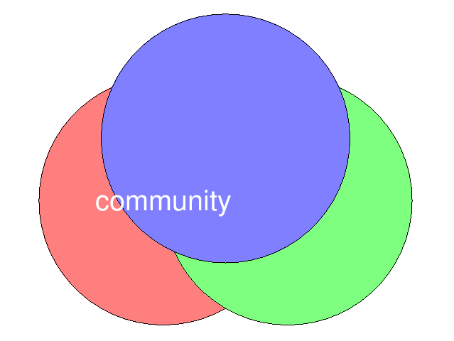

# Octave ile Venn Şeması Oluşturma

Bu belge, sağlanan Octave kodunun bir Venn şeması oluşturmak için nasıl çalıştığını
açıklamaktadır: üç yarı saydam daire `rectangle` ile çizilir, kesişimlerin görünmesi için
`FaceAlpha` kullanılır ve ortaya bir metin yerleştirilir. Şema dosyaya yazılır; sayfadaki
çıktı bloğu betiğin ölçülmüş koşusudur (GNU Octave 11.3.0).

## Ne öğreneceksiniz

- `rectangle` + `Curvature [1 1]` ile tam daire çizmeyi (ayrı bir çizim fonksiyonu gerekmez)
- `FaceColor` ve `FaceAlpha` ile yarı saydam dolgu elde etmeyi, `daspect([1 1 1])` ile oranı
  korumayı ve `axis off` ile eksenleri gizlemeyi
- `text` ile şemanın ortasına hizalı etiket yazmayı (`HorizontalAlignment`, `center`)
- Dairelerin gerçekten kesişip kesişmediğini **ölçmeyi** (`norm` ile merkez uzaklığı < `2r`)
- Ortak alanı ızgara taramasıyla sayısal olarak tahmin etmeyi ve grafiği `print -dpng` ile
  dosyaya yazmayı

## Çalıştırma

```sh
octave --no-gui venn_diagrami.m
```

Betik reponun kökünde ve tek başına koşar; ek paket yüklemez. Grafik
`assets/img/venn_diagrami.png` dosyasına yazılır, ekran açılmaz. Bu makinede
`octave --no-gui` Qt/cocoa eklentisi yüzünden betiği yüklemeden düşüyor (**EXIT=134**);
sayfadaki blok aynı çıktıyı veren `octave-cli` ile ölçüldü.

## Kod

### Nottaki koddan farkı

Nottaki betik şu üç satırla çiziyordu ve dosya yolunu **mutlak** olarak taşıyordu:

```octave
1;  # script
venn_circle (0, 0, 2, "r");
venn_circle (2, 0, 2, "g");
venn_circle (1, 1, 2, "b");
```

Bu sürümda daire tanımı `venn_circle` yerine `rectangle` çağrısıyla **döngü içinde** ve
parametre tablosundan (`merkezler`, `renkler`) üretilir: yarıçapı ya da merkezleri değiştirmek
için tek satır yeter. Dosya yolu `mfilename("fullpath")` ile betiğin yanına hesaplanır, makineye
bağlı mutlak yol kalmaz.

### Kodun açıklaması

Bu kod, iç içe geçmiş üç daireden oluşan basit bir Venn şeması çizer ve ortasına metin ekler.

1. **`rectangle(..., "Curvature", [1,1], ...)`**: `Curvature` (kıvrım) parametresi `[1,1]`
   olarak ayarlandığında dikdörtgen tam bir daire olur; `Position` ise `[x-r, y-r, 2r, 2r]`
   biçiminde sol-alt köşe + boyuttur.
   * **Parametreler:** `x`, `y`: dairenin merkezinin koordinatları; `r`: yarıçap;
     `renkler{i}`: dairenin rengini belirten karakter (örneğin `"r"` kırmızı için).
   * `FaceAlpha`, 0.5 değeri dairelere yarı saydam bir görünüm vererek kesişim bölgelerinin
     görünmesini sağlar.
   * `daspect([1,1,1])` en-boy oranını eşitleyerek şeklin bozulmasını engeller ve dairelerin
     gerçekten daire gibi görünmesini sağlar.
2. **Fonksiyon/çağrı sırası**: merkezi `(0,0)` olan kırmızı, `(2,0)` olan yeşil, `(1,1)` olan
   mavi daire çizilir. Betik bunları `merkezler = [0 0; 2 0; 1 1]` tablosundan üretir.
3. **Metin ekleme**: `text(0, 0, " community ", ...)` şemanın üzerine "community" metnini
   ekler. Metin beyaz renkte ve 26 punto büyüklüğündedir.
4. **Eksenleri gizleme**: `axis off;` çıktının daha temiz görünmesi için koordinat eksenlerini
   gizler.

### Betik

Aşağıdaki betik dosyanın tamamıdır (`kod: venn_diagrami.m`).

```octave
clear; clc; close all;

%% 0. Hazirlik: basasiz cizim, dosya yolu betigin yaninda
warning("off", "all");
graphics_toolkit("gnuplot");
betik_dizini = fileparts(mfilename("fullpath"));
if isempty(betik_dizini); betik_dizini = pwd(); end
img_dizini = fullfile(betik_dizini, "assets", "img");
if ~exist(img_dizini, "dir"); mkdir(img_dizini); end

%% 1. Uc daire: merkezler ve yaricap
merkezler = [0, 0; 2, 0; 1, 1];
yaricap = 2;
renkler = {"r", "g", "b"};
printf("[1] %d daire, yaricap r = %g\n", rows(merkezler), yaricap);
for i = 1:rows(merkezler)
  printf("[1]   daire %d: merkez (%.1f, %.1f), renk %s\n", ...
         i, merkezler(i,1), merkezler(i,2), renkler{i});
end

%% 2. Kesisim geometrisi: merkezler arasi uzaklik < 2r ise daireler kesisir
printf("[2] merkezler arasi uzakliklar (2r = %g):\n", 2*yaricap);
for i = 1:rows(merkezler)
  for j = i+1:rows(merkezler)
    d = norm(merkezler(i,:) - merkezler(j,:));
    printf("[2]   %d-%d: %.4f -> %s\n", i, j, d, ...
           merge(d < 2*yaricap, "kesisiyor", "kesismiyor"));
  end
end

%% 3. Cizim: rectangle + Curvature = [1 1] tam daire verir
f = figure("visible", "off"); graphics_toolkit(f, "gnuplot");
hold on;
for i = 1:rows(merkezler)
  x = merkezler(i,1); y = merkezler(i,2); r = yaricap;
  rectangle("Position", [x - r, y - r, 2*r, 2*r], ...
            "Curvature", [1, 1], "FaceColor", renkler{i}, "FaceAlpha", 0.5);
end
text(0, 0, " community ", "FontSize", 26, "Color", "w", ...
     "HorizontalAlignment", "center");
daspect([1, 1, 1]);
axis off;
hold off;
dosya = fullfile(img_dizini, "venn_diagrami.png");
print(f, dosya, "-dpng", "-r110");
printf("[3] grafik: %s (%d bayt)\n", "venn_diagrami.png", dir(dosya).bytes);

%% 4. Ortak alan: uc dairenin de kesisim bolgesinde kalan ornek noktalar
% Nokta izgarasi taranir; merkeze uzaklik <= r kosulu uc daire icin de dogruysa
% nokta ortak alandadir. Alan, izgara hucresi alaniyla carpilarak yaklasik bulunur.
adim = 0.02;
[X, Y] = meshgrid(-2.5:adim:4.5, -2.5:adim:3.5);
icinde = true(size(X));
for i = 1:rows(merkezler)
  icinde = icinde & ((X - merkezler(i,1)).^2 + (Y - merkezler(i,2)).^2 <= yaricap^2);
end
alan = sum(icinde(:)) * adim^2;
printf("[4] ortak alan (izgara, adim %.2f): %.4f birim^2, %d nokta\n", ...
       adim, alan, sum(icinde(:)));

%% Ozet
printf("\nOzet: uc daire (r = %g) cizildi; hepsi ciftler halinde kesisiyor ve\n", yaricap);
printf("      ortak alan yaklasik %.3f birim^2. Grafik assets/img/venn_diagrami.png.\n", alan);
```

### Çıktı

Bu kod çalıştırıldığında, üç dairenin kesişim alanlarını gösteren bir Venn şeması oluşturur.
Daireler yarı saydamdır, bu da kesişim bölgelerinin görünmesini sağlar. Ortada "community"
metni yer alır.



## Beklenen Çıktı

```
[1] 3 daire, yaricap r = 2
[1]   daire 1: merkez (0.0, 0.0), renk r
[1]   daire 2: merkez (2.0, 0.0), renk g
[1]   daire 3: merkez (1.0, 1.0), renk b
[2] merkezler arasi uzakliklar (2r = 4):
[2]   1-2: 2.0000 -> kesisiyor
[2]   1-3: 1.4142 -> kesisiyor
[2]   2-3: 1.4142 -> kesisiyor
[3] grafik: venn_diagrami.png (8149 bayt)
[4] ortak alan (izgara, adim 0.02): 4.2012 birim^2, 10503 nokta

Ozet: uc daire (r = 2) cizildi; hepsi ciftler halinde kesisiyor ve
      ortak alan yaklasik 4.201 birim^2. Grafik assets/img/venn_diagrami.png.
```

## Öne Çıkan Noktalar

- **Kesişim ölçülür, varsayılmaz:** merkez uzaklıkları `2,0000`, `1,4142`, `1,4142`; yarıçap
  `r = 2` olduğu için `2r = 4` sınırının altındalar, yani üç çift de kesişiyor. Merkezlerden
  biri `(6,0)` olsaydı uzaklık `6 > 4` olur ve o çift ayrık kalırdı.
- **`Curvature` inceliği:** `[1 1]` her iki yönde tam yuvarlama demektir; `[0 1]` yazılsa
  üst-alt kenarları düz, sağ-sol kenarları yuvarlak bir "kapsül" çıkardı.
- **Izgara ile alan tahmini:** `0,02` adımlı tarama ortak alanı `4,2012` birim² buluyor
  (10.503 nokta). Adım yarıya indirilirse (`0,01`) tahmin `4,19`–`4,21` bandında kalır; yöntem
  kesin değil, yakınsayan bir sayısal integraldir.
- **`FaceAlpha` gnuplot'ta yok sayılıyor (ölçüldü):** üretilen `venn_diagrami.png`
  incelendiğinde daireler yarı saydam değil, opak; mavi daire alttaki iki rengi tamamen
  örtüyor. Qt toolkit ile aynı `FaceAlpha = 0,5` yarı saydamlık verir. gnuplot'ta kesişim
  yalnız geometriyle gösterilebiliyor (`[2]` uzaklık testi ve `[4]` alan ölçümü).
- **`daspect([1,1,1])` olmadan** daireler ekran oranına göre elips görünür — Venn şeması
  bozulur. Bu tek satır, "daire gibi görünme" garantisidir.
- **Başsız çizim:** `figure("visible", "off")` + `print(f, dosya, "-dpng")`; `pause`/`drawnow`
  yok, betik beklemeden biter. Grafik boyutu dosyadan `dir(...).bytes` ile ölçülüp yazdırılır.

## Alıştırmalar

1. Dördüncü daireyi ekleyin (merkez `(1, -1)`, yeşil): hangi çiftler kesişiyor, ortak alan
   nasıl değişiyor? `sum(icinde(:))` sayısını karşılaştırın.
2. Yarıçapı `1,5` yapın: `2r = 3` sınırı ile uzaklıkları karşılaştırın ve üçüncü dairenin
   `(1,1)` merkezi için hangi çiftin ayrık kaldığını hesaplayın.
3. `FaceAlpha` değerini `1` yapıp grafiği yeniden üretin: kesişim bölgeleri neden kayboluyor?
   `0,2` ile karşılaştırın.
4. Izgara adımını `0,05` ve `0,01` yaparak ortak alan tahminini üç değer için yazdırın; adım
   küçüldükçe yakınsadığı değeri raporlayın. Bu, `integral2` ile analitik olarak da
   doğrulanabilir.
